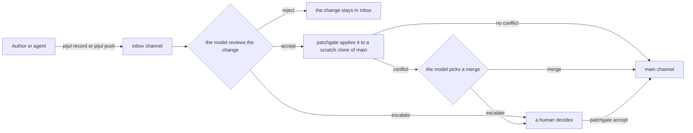

# patchgate

patchgate puts a local model in front of a [Pijul](https://pijul.org) repository. Authors and agents add changes to the `inbox` channel. The model reviews each change, and it merges the conflicts between changes. patchgate applies the result to the `main` channel, so `main` never has a conflict. Nobody records in `main` directly.



## How patchgate decides

patchgate examines the inbox changes that are not in main, in the order of the inbox log. It does these steps for each change:

1. If a dependency of the change is not in main, the change waits. If that dependency has the state `rejected`, `escalated`, or `blocked`, patchgate blocks the change. `pijul apply` also applies the dependencies of a change, so patchgate never applies a blocked change.
2. If the change touches a protected path, patchgate escalates the change to a human. The model does not see the change.
3. If the change text is longer than `PATCHGATE_MAX_CHANGE_CHARS`, patchgate escalates the change. The model never sees a part of a change.
4. Else, patchgate sends the change and the `POLICY.md` of main to the model. The model replies with `accept`, `reject`, or `escalate`, a summary, and a reason.
5. patchgate applies each accepted change to a scratch clone of main. If the change conflicts with main, the model merges the conflict, as the next section tells.
6. patchgate applies the change, and its merge, to main.

patchgate reads the policy from main, not from the working copy. Thus a pending change cannot change the rules for its own review. A change to `POLICY.md` always goes to a human.

The decisions and the merges go into `.pijul/patchgate/ledger.jsonl`.

## How patchgate merges conflicts

Two changes conflict when each edits the same place in a file, and neither change knew about the other. Pijul keeps both sides of the conflict. patchgate reads the sides with `pijul credit`.

patchgate builds each merge that it can make exactly from the lines of the sides and of the changes. The model gets the file, the hunks of each change, the lines around the conflict, and the full result of each choice. It picks one choice, or it escalates the conflict to a human. The model never writes a line.

| Conflict | The choices of the model |
| --- | --- |
| Order conflict: the sides add lines at the same place | both sides with side 1 first, both sides with side 2 first, only side 1, only side 2 |
| Order conflict: the sides replace the same lines | none. A human must choose the value. |
| Deletion conflict: one change deletes lines, and the other change inserts lines among them | the deletion wins, keep the inserted lines |
| Deletion conflict: the other change edits lines that the deletion removes | the deletion wins, restore the deleted lines with the edit |
| Name conflicts and the other kinds | none. A human decides. |

patchgate records the merge in the scratch clone as a new Pijul change. The author of the change is `patchgate`, and pijul signs it with the key of the gate in `.pijul/patchgate/key`. patchgate makes that key at the first merge, and it runs a private ssh-agent for each merge. Then patchgate applies the conflicting change and the merge to main together. It also applies the merge to the inbox.

If the working copy has unrecorded changes, pijul does not apply the merge to the inbox. `patchgate status` then shows the merge, and the command that applies it.

### When a human must merge

The inbox has both sides of an escalated conflict, so the working copy shows the conflict markers. Edit the file, record the result, and accept that change:

```console
$ patchgate status
1 change(s) in inbox are not in main:
escalated ADR7OYX4QT6Q  Serve on port 9090
                        The change conflicts with main, and patchgate did not merge it. server.conf: The sides replace the same lines with different text, so a human must choose one. To merge it by hand, edit the conflict in inbox, record the result, and run: patchgate accept <hash of the result>
$ $EDITOR server.conf
$ pijul record -a -m "Serve on port 9090"
$ patchgate accept <hash of the change that you recorded>
```

`patchgate accept` applies the escalated change and your resolution to main together.

## Models

A model with more parameters merges better, but it is slower. These are the results of six reviews and three conflicts in the same repository, on an Apple M4 with 24 GB:

| Model | Two greetings at one place | A deleted function that the other change edits | Two values for one port | Time |
| --- | --- | --- | --- | --- |
| `google/gemma-4-e4b` (the default) | both sides | the deletion wins | escalated by patchgate | 39 s |
| `ternary-bonsai-27b-mlx` | both sides | restore the deleted lines with the edit | escalated by patchgate | 2 min 18 s |

LM Studio estimates that `qwen/qwen3.6-27b` needs 21 GiB, so its guardrails refuse that model on this machine. A thinking model on LM Studio can put its answer in `reasoning_content`, and patchgate reads that field when `content` is empty.

## Requirements

- [devenv](https://devenv.sh) 2.4 or later.
- A model server with an OpenAI-compatible API. The default is LM Studio at `http://127.0.0.1:1234/v1` with the model `google/gemma-4-e4b`. LM Studio loads the model when the first request comes.
- An SSH agent with an Ed25519 key. `pijul record` signs each change with a key from the agent.

## Start

```console
$ devenv shell
$ pijul init
$ pijul add -r .
$ pijul identity new --no-link --display-name "Your Name" --email you@example.com personal
$ pijul record -a -m "Start the patchgate project"
$ patchgate init
```

A git clone has no `.pijul` directory, so `pijul init` and `pijul add -r .` make the Pijul repository. `.ignore` tells pijul to skip `.git` and the devenv state. The identity is optional. Without it, pijul records your changes as `Anonymous`.

Record the first change in `main`, before `patchgate init`, because the gate cannot review its own start. `patchgate init` makes the `inbox` channel from `main` and puts the working copy on `inbox`.

## Daily use

Record changes in the inbox as usual, and then review them. In this example, another author pushed "Greet in German" to the inbox, and it conflicts with your change:

```console
$ pijul record -a -m "Greet in French"
$ patchgate review
accepted  YY4RHQAWXKKP  Greet in French
                        The change adds a single line of code (`echo bonjour`) to greet.sh, which is described by the message 'Greet in French', and no reject or escalate rules apply.
accepted  QIRFJ55FGCJE  Greet in German
                        The change adds a single line of code (`+ echo hallo`) which appears to be part of the project's intended functionality (a greeting), and the message clearly describes this addition ('Greet in German'). No reject or escalate rules apply.
merged    IVAUUKCQKXYK  Merge the conflict between "Greet in French" and "Greet in German"
                        greet.sh: both, side 1 first. Both changes add a greeting line, and since they are in different languages, both greetings should be present before the final goodbye.
```

`devenv up` runs `patchgate watch`, which reviews new inbox changes every 10 seconds.

Other authors and agents clone the repository, record, and push to the inbox:

```console
$ pijul clone /path/to/patchgate work
$ cd work
$ pijul record -a -m "Greet in German"
$ pijul push /path/to/patchgate --to-channel inbox --no-notify -a
```

To correct a rejected change, unrecord it from the inbox and record a new change. The new change has a new hash, so patchgate reviews it again. `pijul unrecord` keeps your files as they are.

```console
$ pijul unrecord UBJWLW7I3DXC
$ pijul record -a -m "Add the deploy configuration without the key"
```

To publish the reviewed work, push main: `pijul push <remote> --from-channel main`.

## Commands

| Command | What it does |
| --- | --- |
| `patchgate init` | Makes the `inbox` channel from `main` and puts the working copy on it. |
| `patchgate status` | Shows each inbox change that is not in main, with its state. It also shows each merge that the inbox does not have. |
| `patchgate review` | Reviews and merges the pending changes one time. |
| `patchgate watch` | Reviews and merges new changes every 10 seconds until you stop it. `devenv up` runs it. |
| `patchgate accept <hash>` | A human accepts the change. patchgate applies it to main, with the escalated conflicting changes that it resolves. |
| `patchgate reject <hash>` | A human rejects the change. |
| `patchgate log` | Shows the decisions and the merges, newest first. |

A hash can be the start of a hash, for example `FTH4472WYKIZ`.

| State | Meaning |
| --- | --- |
| `pending` | The change is ready for review. |
| `waiting` | A dependency of the change is pending. |
| `blocked` | A dependency of the change is rejected, escalated, or blocked. A human must decide about that dependency. |
| `rejected` | The model or a human rejected the change. |
| `escalated` | patchgate or the model asks a human to decide. A conflict that patchgate did not merge has this state too. |
| `removed` | patchgate accepted the change, but a human removed it from main. patchgate does not apply it again. |

## Configuration

`devenv.nix` sets these variables. To use a different model one time, set the variable on the command line, for example `PATCHGATE_MODEL=ternary-bonsai-27b-mlx patchgate review`.

| Variable | Default | Use |
| --- | --- | --- |
| `PATCHGATE_MODEL_URL` | `http://127.0.0.1:1234/v1` | The base URL of the OpenAI-compatible API. Ollama uses `http://127.0.0.1:11434/v1`. |
| `PATCHGATE_MODEL` | `google/gemma-4-e4b` | The name of the model on the server. |
| `PATCHGATE_PROTECTED` | the gate files | Glob patterns, with commas between them. A human must accept each change to a path that matches. |
| `PATCHGATE_POLICY` | `POLICY.md` | The policy file in main. patchgate always protects it. |
| `PATCHGATE_MAX_CHANGE_CHARS` | `8000` | patchgate escalates a longer change text, or a longer conflict, without the model. |
| `PATCHGATE_TIMEOUT` | `300` | The seconds to wait for one reply. The first reply includes the time to load the model. |
| `PATCHGATE_INBOX`, `PATCHGATE_MAIN` | `inbox`, `main` | The channel names. The `--inbox` and `--main` options also set them. |

## Limits

- The working copy is on `inbox`, so it contains changes that main does not have. patchgate controls main. It does not isolate the code in the inbox.
- LM Studio loads a model with a context of 4096 tokens when a request loads it. The limit of 8000 characters keeps a change, the policy, and the reply in that context. For larger changes, load the model with a larger context, and then increase `PATCHGATE_MAX_CHANGE_CHARS`.
- patchgate merges only the conflicts in the table above. A merge that needs a new line, for example a line that combines both sides, goes to a human.
- A local model makes mistakes. Examine `patchgate log` and correct a decision with `patchgate accept` or `patchgate reject`. To remove a merge from main, run `pijul unrecord --channel main <hash>`.

## Tests

The tests are [Harbor](https://harborframework.com) tasks in `harbor/tasks`. Each task starts from a Pijul repository with a fixed history, and its verifier examines the channels and the ledger of that repository.

| Task | What patchgate must do |
| --- | --- |
| `merge-order-conflict` | Merge two greetings at one place. |
| `merge-deletion-conflict` | Restore a deleted function, with the line that the other change edits. |
| `unsafe-merge-escalates` | Refuse to keep an edited line without the deleted function around it. |
| `value-conflict-escalates` | Escalate two values for one port, also when the model picks a value. |
| `human-resolves-conflict` | Land a resolution that a human records, with the escalated change. |
| `name-conflict-escalates` | Escalate two new files with the same name. |
| `rejected-dependency-blocks` | Keep a change out of main when it needs a rejected change. |
| `policy-change-needs-human` | Review with the policy of main, and escalate a change to the policy. |
| `rename-onto-protected-path` | Escalate a move onto a protected path. |
| `model-outage-decides-nothing` | Decide nothing while the model server fails. |
| `invalid-reply-escalates` | Escalate a change when the reply has no verdict. |
| `long-change-escalates` | Escalate a long change without the model. |
| `new-inbox-root-change` | Land the root change, and wait for a policy in main. |

`devenv test` runs `patchgate-harbor check`. It runs each task with the `oracle` agent and with the `nop` agent. It fails unless the oracle gets reward 1 and the nop agent gets reward 0 on each task. The oracle runs patchgate with a scripted model server in the task. The nop agent changes nothing, which proves that a verifier does not pass an unchanged repository. The tests do not use the local model.

`patchgate-harbor` does these steps:

1. It builds the image `patchgate-harbor:dev` from `harbor/Dockerfile`. The image builds `harbor/environment.nix` with the nixpkgs of `devenv.lock`, so the tasks use the same pijul and Python as the devenv shell. The Nix build runs `harbor/scenarios.py setup-all`, which makes the repository of each task.
2. If Docker does not answer, it starts the Colima profile `patchgate`. Colima shares only the home directory with its virtual machine, and Harbor reads each reward through that share. Thus the Harbor jobs stay in `.devenv/state/harbor-jobs`. To use another Docker engine, set `DOCKER_HOST`. To stop the virtual machine, run `colima stop patchgate`.
3. It installs Harbor 0.24.0 from the hash-locked `harbor/requirements.txt` in `.devenv/state/harbor`.

To run another Harbor agent on the tasks, give its options to `patchgate-harbor run`, for example `patchgate-harbor run --agent nop`. Each task also has `environment/default.nix` for the bubblewrap backend of Harbor. That backend runs only on Linux, so the Docker image is the environment on macOS.
